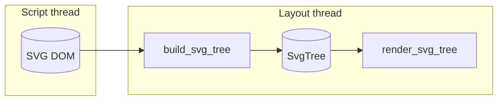
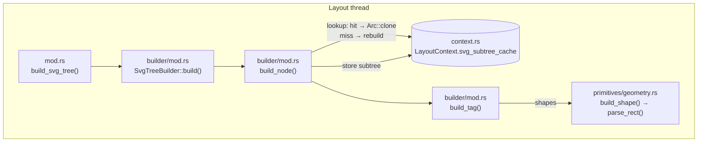
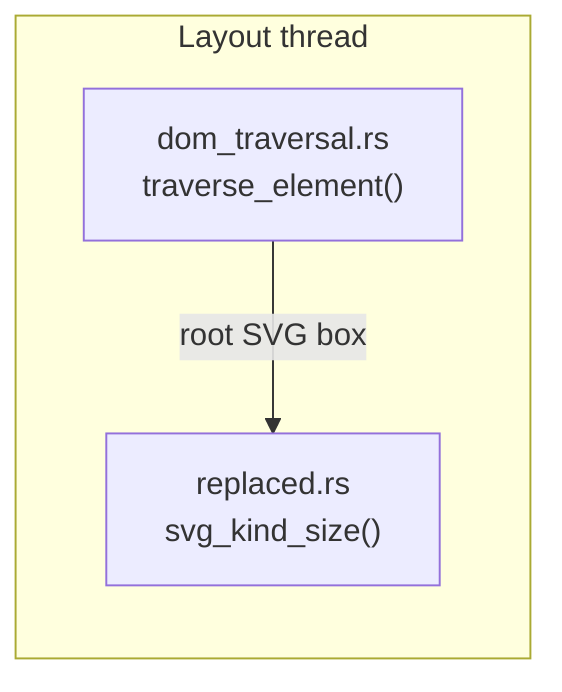
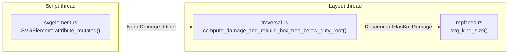
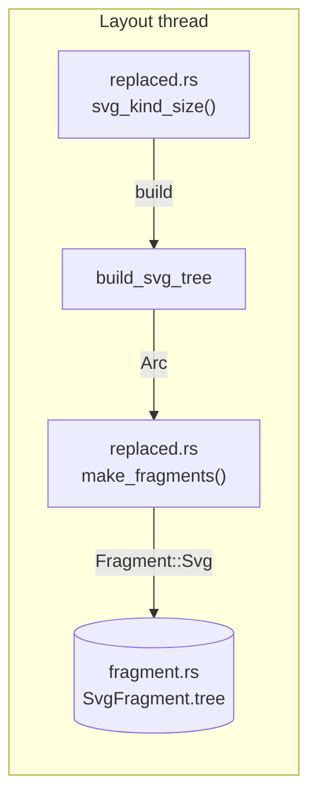
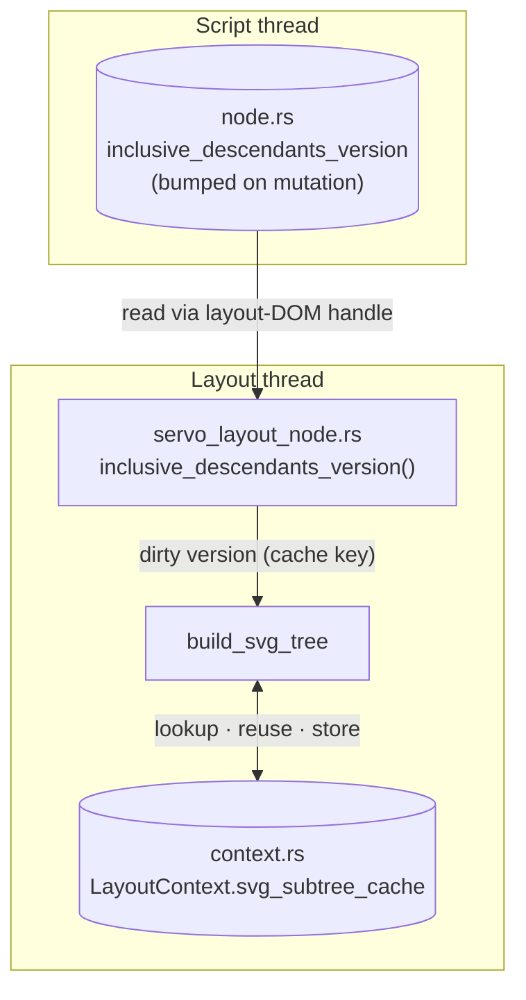
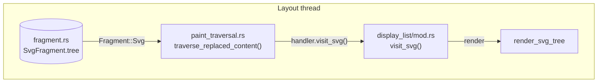

# Servo SVG — Data Flow (integration points)

> Everything *around* the two passes, plus a look *inside* `build_svg_tree`. This
> documents the files changed **outside** `components/layout/svg/` and
> `components/svg/` — the glue that connects `build_svg_tree` and
> `render_svg_tree` to the rest of Servo — and how `build_svg_tree` walks the DOM
> and reuses cached subtrees.

## The two black boxes

| Box | Signature | Contract |
|---|---|---|
| **`build_svg_tree`** | `DOM → Arc<SvgTree>` | Walks the SVG DOM, parses `<rect>` geometry, reuses cached subtrees, returns a pure `SvgTree`. |
| **`render_svg_tree`** | `SvgTree → (nothing yet)` | Walks the built tree; currently a `debug!`-log traversal — WebRender display-list emission lands with the real renderer. |

Everything below is about who calls them, how the result is carried, how Servo
decides *when* to call them, and how `build_svg_tree` itself reuses subtrees.

## Overview

One-line picture: DOM is *built* into a tree, then *rendered*. The pipeline spans
three threads: the DOM lives on the **script thread**, the build and render passes
both run on the **layout thread**, and the finished display list is handed to
**WebRender** (in a later PR — the renderer today only logs).

The two halves join at a single hand-off point — the `SvgFragment.tree` field on a
`Fragment::Svg` — so they are shown separately below: that node ends the build flow
and starts the render flow.

### Shape key

Every diagram below uses the same two shapes, consistently:

- **Rectangle** `["…"]` — a **function**, labelled `file · function_name()`.
  `build_svg_tree` and `render_svg_tree` are functions too, so they share this shape.
- **Cylinder** `[("…")]` — **data**: a field, a tree, a cache, or a render target.

Values in flight (`NodeDamage::Other`, `Arc<SvgTree>`, …) ride the edge labels, so
they don't get a shape of their own.

### Thread key

Each diagram below wraps its nodes in a **subgraph** named after the thread that
runs them, so the thread crossings are visible instead of implicit:

- **Script thread** — owns the DOM: `attribute_mutated()`, damage flags, and the
  `inclusive_descendants_version` bumps all happen here.
- **Layout thread** — reads the DOM through thread-safe layout-DOM handles and does
  the work: `svg_kind_size()`, `build_svg_tree`, the subtree cache, and
  `render_svg_tree`.
- **WebRender** — the render backend that receives the finished display list (in a
  later PR).

Only two boundaries are ever crossed: **script → layout** (the DOM: damage, the
subtree version, the initial box) and **layout → WebRender** (the display list).

## Inside `build_svg_tree`

`build_svg_tree` is the layout/svg entry point. It delegates to `SvgTreeBuilder`,
which walks the DOM depth-first and consults the subtree cache at every non-root
node, so an unchanged subtree is reused (an `Arc` clone) instead of rebuilt.

In prose, one `build_node` step:

1. `as_element()?` — text / whitespace / comment children produce no node.
2. Read the two cache-key inputs: `computed_style(node)` and
   `inclusive_descendants_version()`.
3. If not the root: `lookup`. A **hit** returns the cached `Arc<SvgNode>`
   immediately; a **miss** falls through to rebuild (and logs which input changed).
4. `build_tag(element, computed, vw, vh)` maps the element to a tag — `<svg>`/`<g>`
   to a container, shapes to `build_shape` (`parse_rect` for `<rect>`), everything
   else to `None`.
5. Recurse into children, collecting `Vec<Arc<SvgNode>>`.
6. `Arc::new(SvgNode { … })`, and (if not root) `store` it in the cache.

`parse_rect` reads `x`/`y`/`rx`/`ry` from the computed style
(`computed.get_svg()`), falling back to the raw attributes for unstyled nodes, and
`width`/`height`/`pathLength` from attributes. A negative `width`/`height` yields
no shape; an `auto`/negative `rx`/`ry` is stored as `None`.

### Cache key and miss reasons

| Input | Invalidate on | Miss variant |
|---|---|---|
| node identity (`OpaqueNode`) | — (the map key) | `NoEntry` (no entry yet) |
| `inclusive_descendants_version` | any mutation in the subtree | `SubtreeDirty` |
| computed style (`Arc<ComputedValues>`, `ptr_eq`) | own/inherited property, stylesheet rule, pseudo-class | `ComputedStyle` |

The cache lives on `LayoutContext.svg_subtree_cache`
(`Arc<RwLock<SvgSubtreeCache>>`), created in `layout_impl.rs` and cloned into every
reflow's `LayoutContext`.

## Build data flow — who calls `build_svg_tree`

`build_svg_tree` is reached by **two routes** that both land on `svg_kind_size()`;
after that they share **one tail**. Each is shown as its own straight-line flow —
no fan-in, no crossing.

### Route A — initial box construction

On the first layout, `traverse_element()` walks the whole DOM and lets the root
`<svg>` through as a replaced box; its `ReplacedContents::for_element` (via
`as_svg()`) calls `svg_kind_size()`.

### Route B — incremental rebuild

On a later reflow, `attribute_mutated()` marks the SVG element dirty
(`NodeDamage::Other`); that flows through restyle into `LayoutDamage`, which
`compute_damage_and_rebuild_box_tree_below_dirty_root()` upgrades to
`DescendantHasBoxDamage`, forcing the root `<svg>` box to re-run `svg_kind_size()`.
`attribute_mutated()` runs on the script thread and the damage upgrade runs on the
layout thread, so the `NodeDamage::Other` edge is this route's one script→layout
crossing.

### Build call → hand-off (the shared tail)

| Component | What it does |
|---|---|
| `script/dom/svg/svgelement.rs` | `SVGElement::attribute_mutated()` marks the node dirty (`NodeDamage::Other`) on any attribute change, so the nearest root `<svg>` is flagged for rebuild. |
| `script/dom/element/element.rs` + `script/layout_dom/servo_layout_element.rs` | `is_svg_element()` — an SVG-namespace check used by layout traversal to recognise SVG elements. The helper lives on `LayoutDom<Element>`; `ServoLayoutElement::is_svg_element()` delegates to it. |
| `layout/dom_traversal.rs` | The root `<svg>` is recognised as *replaced* content, and replaced elements are atomic — layout never descends into their children. So no child SVG element (or nested `<svg>`) ever gets a layout box; the whole subtree is built by `build_svg_tree`. |
| `layout/traversal.rs` | Damage upgrade: when an SVG element has `Relayout` damage, it is promoted to `DescendantHasBoxDamage`, forcing the root `<svg>` box to rebuild (which re-runs `build_svg_tree`). |
| `layout/replaced.rs` | `svg_kind_size()` computes the resolved viewport size and calls `build_svg_tree`, returning `ReplacedContentKind::Svg(render_tree)`. `make_fragments()` then wraps that into a `Fragment::Svg(Arc<SvgFragment>)` carrying `tree: Some(tree)`. |
| `layout/fragment_tree/fragment.rs` | The `Fragment::Svg(Arc<SvgFragment>)` variant and the `SvgFragment` struct — its `tree: Option<Arc<SvgTree>>` field is the hand-off slot that carries the built tree from build to render. |

### Cache flow (reuse vs rebuild)

For each subtree, `build_svg_tree` keys the cache by the node's identity, its
`inclusive_descendants_version`, and its computed style. A **hit** reuses the
cached subtree; a **miss** rebuilds it and stores it for the next reflow. The
version cell lives on the script-thread DOM node (bumped on every mutation) and is
read through the layout thread's `ServoLayoutNode` handle.

| Component | What it does |
|---|---|
| `script/layout_dom/servo_layout_node.rs` | Implements `inclusive_descendants_version()` — the dirty-version half of the cache key, read by the builder. |
| `script/dom/node/layout_dom.rs` | Exposes `inclusive_descendants_version()` on the layout-DOM wrapper so layout can read the persistent subtree version. |
| `shared/layout/layout_node.rs` | The `LayoutNode` trait: declares `inclusive_descendants_version()` so the builder can call it through the trait. |
| `layout/context.rs` | `LayoutContext.svg_subtree_cache` — the persistent subtree cache (`Arc<RwLock<SvgSubtreeCache>>`), cloned into every reflow's context. |
| `layout/layout_impl.rs` | Creates the cache (`Default`) and clones it into every `LayoutContext`; also registers the `servo-svg.css` UA stylesheet (`svg > * { display: inline; }`) when the pref is on. |

## Render data flow

Who consumes the hand-off tree, and where it ends up:

> The render side is thin *outside* the black box — and, for now, thin *inside*
> too: `render_svg_tree` walks the tree and `debug!`-logs each node's tag. Real
> WebRender display-list emission is the next PR.

### Render

| Component | What it does |
|---|---|
| `layout/display_list/mod.rs` | `visit_svg()`: reads `fragment.tree` and calls `render_svg_tree(...)` — instead of the normal image raster path. |
| `layout/display_list/paint_traversal.rs` | Adds the `visit_svg` handler method (default no-op) to the `PaintTraversalHandler` trait, and `traverse_replaced_content()` dispatches `Fragment::Svg` → `handler.visit_svg()`. |
| `layout/display_list/stacking_context.rs` | `build_stacking_context_tree()` treats `Fragment::Svg(_)` as a leaf (no children to recurse into). |
| `layout/query.rs` | `resolved_size_should_be_used_value()` returns `true` for `Fragment::Svg` — SVG is replaced content, so its size is the used value. |

## Pref wiring

The engine is compiled unconditionally and switched on with the
`layout_servo_svg_enabled` pref (default `false`, so the legacy resvg path
stays the default).

| Component | What it does |
|---|---|
| `config/prefs.rs` | Adds `layout_servo_svg_enabled` (default `false`). |
| `layout/Cargo.toml` | `servo-svg`, `html5ever` and `svgtypes` are non-optional deps (no feature flag). |
| `layout/replaced.rs` | `svg_kind_size()` picks the pipeline: `build_svg_tree` when the pref is on, legacy serialization otherwise. |
| `layout/traversal.rs` | Upgrades SVG restyle damage to box damage only when the pref is on. |
| `layout/layout_impl.rs` | Registers the `servo-svg.css` UA stylesheet only when the pref is on. |

## Notes

- **Legacy path is the default.** With the pref off, the old CPU-rasterization
  path (`image_cache` serialization → `rasterize_vector_image`) is used. With
  the pref on, `replaced.rs` builds an `Arc<SvgTree>` straight from the DOM
  instead.
- **Direction of data.** Build is *pull* (layout asks `build_svg_tree` for a
  tree, reusing the cache). Render is *push* (the tree is handed to
  `render_svg_tree`, which — in a later PR — writes display items into the
  WebRender builder).
